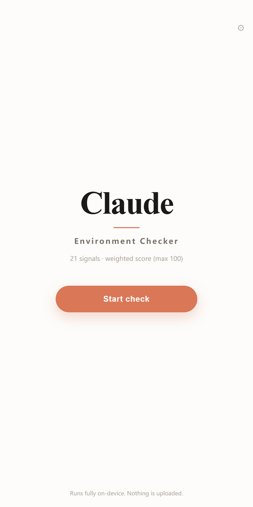
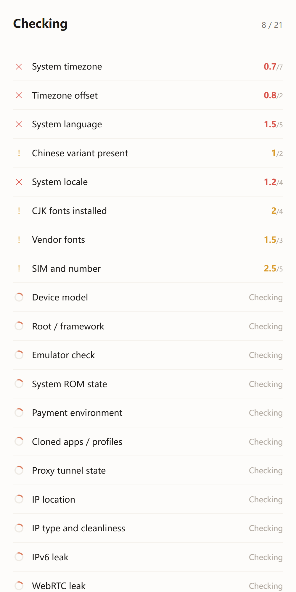
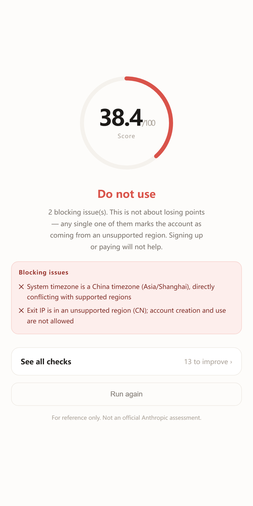
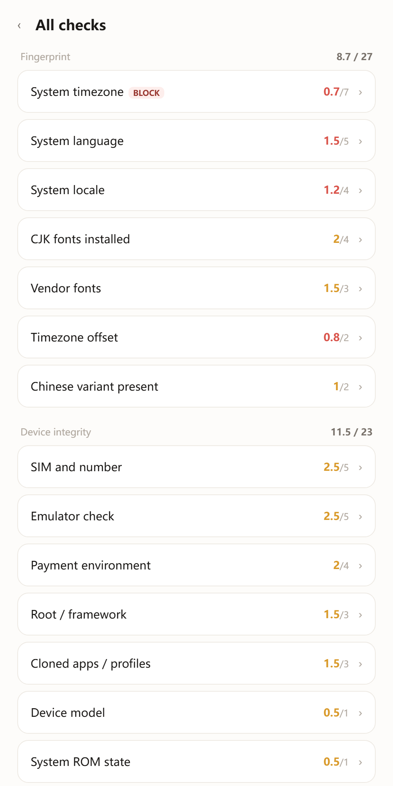
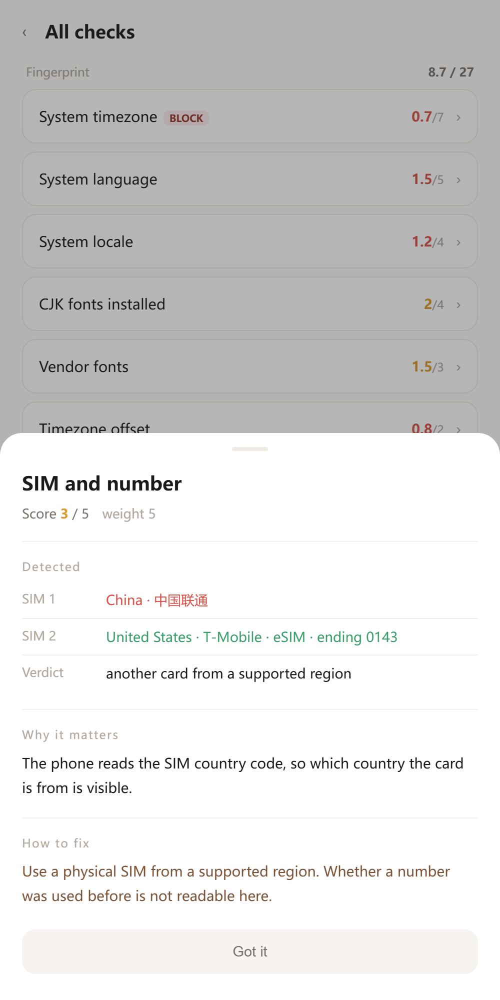
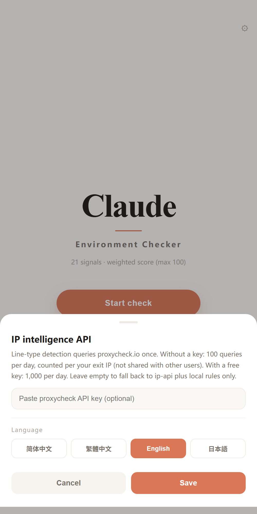

<div align="center">

# Claude Environment Check

**Before you open Claude, look at what your device is telling them.**

21 signals · weighted scoring · on-device · open source

[](LICENSE)
[](#install)
[](#install)
[](#privacy)

<p align="center">
  <a href="README.md"></a>
  <a href="README.zh-TW.md"></a>
  <a href="README.en.md"></a>
  <a href="README.ja.md"></a>
</p>

</div>

---

## What this is

A diagnostic app for your phone. It reads the signals your device already emits and tells you whether this environment looks like **an ordinary user overseas**, or like **a set of fingerprints that have been flagged before**.

Unlike a check that runs in a browser, this is a native Android app, so it reaches things a page never can: which fonts are installed in the system, which country the SIM belongs to, whether it is an eSIM, whether app cloning is in use, whether the ROM is official, whether the VPN is system-wide.

You get a score out of 100 and one sentence of conclusion. The score itself is not the point. What matters is **which item is dragging you down, why, and how to fix it**.

Each result is listed as labelled fields, not one blob of text. Values are colour-coded normal / note / problem, so on a dual-SIM phone card 1 turns red and card 2 green — you can see which card is the issue at a glance.

Anything it cannot read is never counted as a pass. An unrecognised SIM or an unparseable region is labelled “cannot determine” and given a middle score — no guessing, no free pass.

<br>

<div align="center">
<table>
<tr>
<td></td><td></td><td></td>
</tr>
<tr>
<td align="center">Home</td><td align="center">Scanning</td><td align="center">Score</td>
</tr>
<tr>
<td></td><td></td><td></td>
</tr>
<tr>
<td align="center">Breakdown</td><td align="center">Item detail</td><td align="center">Settings</td>
</tr>
</table>
</div>

---

## What it checks

21 items, scored by how much each one actually weighs in risk decisions. **The same mistake costs wildly different amounts depending on the item.**

| Weight | Item | Why this weight |
|:---:|---|---|
| **20** | IP location | A hard gate written into the policy; instant veto |
| **13** | IP type and cleanliness | Datacenter and residential are treated nothing alike, and many "residential" proxies are datacenter IPs renamed |
| 7 | System timezone | The most direct evidence of physical location |
| 6 | IPv6 leak | A real exit that bypasses the tunnel |
| 5 | WebRTC leak / timezone vs IP / emulator / system language / SIM | Not fatal alone, heavy when stacked |
| 4 | System locale / CJK fonts / payment environment | Mid-layer profiling signals |
| 3 | Root / vendor fonts / cloned apps | Environmental trust |
| 2 | Chinese variant / timezone offset | Small contradictions |
| 1 | Device model / ROM state / proxy tunnel / reachability | Informative, but should not sink the total |

Full rules, hidden heuristics and known misjudgements live in **[docs/DETECTION.md](docs/DETECTION.md)** — including what counts as a failure for every item.

### Five instant vetoes

Hit any one and the verdict is "do not use", regardless of score:

- System timezone is a mainland China timezone
- Exit IP is in an unsupported region
- IPv6 exit differs from the IPv4 region
- WebRTC exposed a public address from another region
- Running on an emulator or cloud phone

---

## A small example

Same "deduction", twenty times the cost:

```
Wrong device model (a Xiaomi phone)   → lose 1 point
IP in an unsupported region           → lose 20 points, and get vetoed
```

That is why items are not all worth 10. An early build scored every item out of 10, which meant "your phone is a Xiaomi" and "you are in mainland China" cost exactly the same. That number was meaningless.

---

## Install

**Install the APK**

Download **[ClaudeDoctor.apk](https://github.com/know317028210-blip/claude-android-checker/releases/latest/download/ClaudeDoctor.apk)** (69 KB) and allow installs from unknown sources.

Version history is on [Releases](../../releases).

---

## Build it yourself

No Gradle needed — just the Android SDK (build-tools + platform 34) and a JDK.

```bash
git clone https://github.com/<your-name>/claude-doctor.git
cd claude-doctor/android
bash build.sh
```

The script runs `aapt2 compile → link → javac → d8 → zipalign → apksigner`, produces a 69 KB APK and installs it to any connected device.

> The first build creates `android/keystore.jks`. That is your signing key, already excluded in `.gitignore`. **Do not commit it.**

---

## Privacy

- Every decision happens on device; results never leave it
- Only the IP checks contact external services, and they send your **exit IP** because the query cannot work without it
- No device identifiers, no accounts, no location, no contacts
- No analytics, no telemetry, no sign-up

External endpoints and their free quotas are listed in [docs/DETECTION.md](docs/DETECTION.md#六外部接口与配额).

---

## Scope

This is a **diagnostic tool**. It does not provide any means of bypassing regional restrictions and it does not modify system settings — it reads, then reports.

Results are indicative, not an official Anthropic assessment. Real risk decisions are dynamic and multi-dimensional; this tool produces a risk profile from public policy and community observation.

If you are in a supported region on a normal device and home broadband, you should score high. If you score low, the environment really does contain contradictions worth fixing before signing in.

---

## Contributing

Issues and PRs welcome. Especially:

- **New checks** — particularly native-only ones (sensor consistency, GPU model, DNS egress)
- **False positive reports** — include your measured values and reasoning; these are the most valuable
- **Translations** — currently zh-CN, zh-TW, en, ja
- **Intelligence sources** — keyless, quota-friendly IP APIs

No style guide. Working code that explains itself is enough. Detection logic lives in the `CHECKS` array inside `app/index.html`; adding a check means adding an object.

---

## License

[MIT](LICENSE)

<div align="center">
<sub>Runs locally. Uploads nothing. Go fix your timezone.</sub>
</div>
