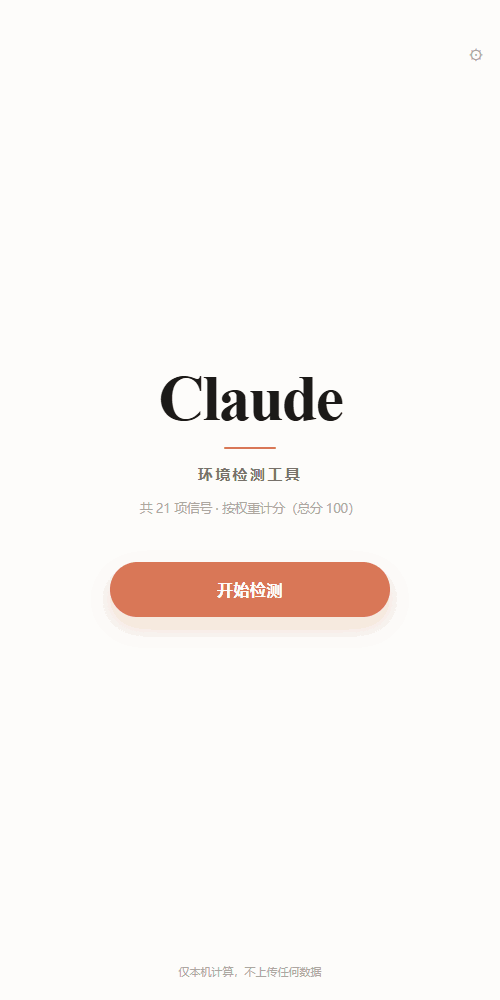
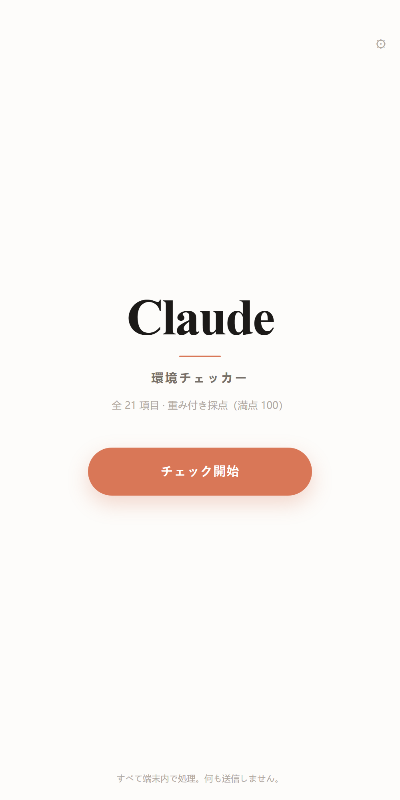
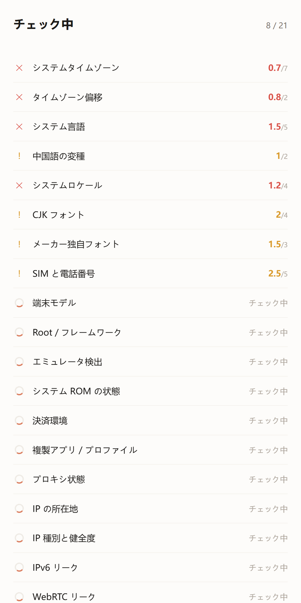
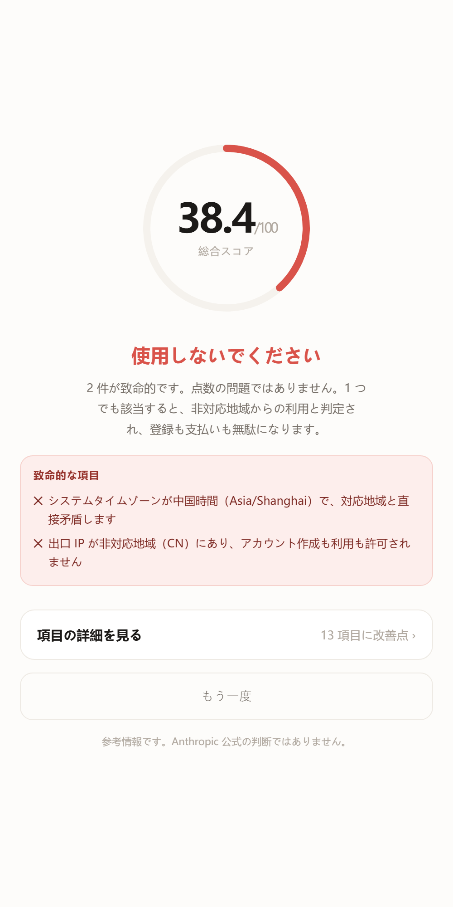
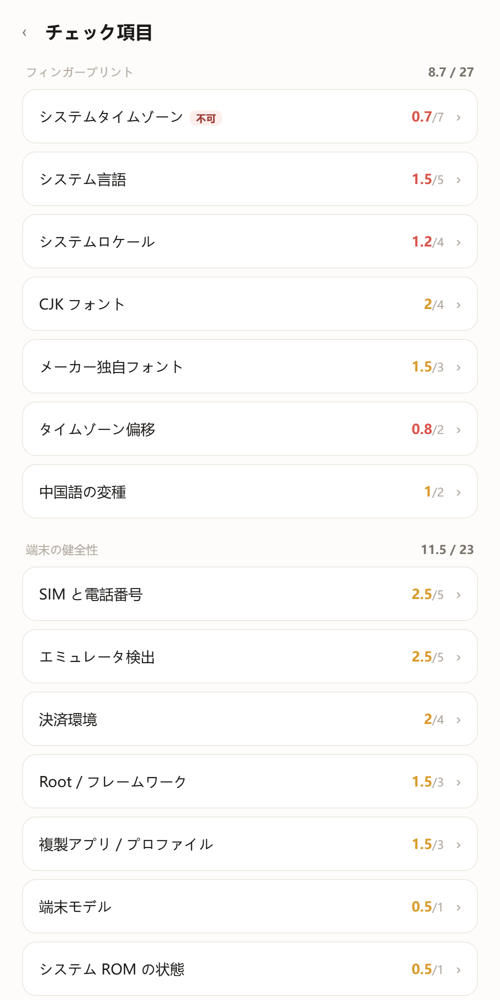
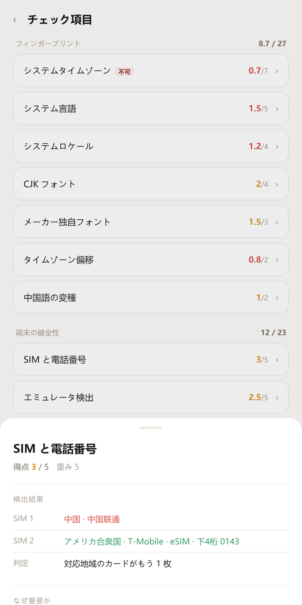
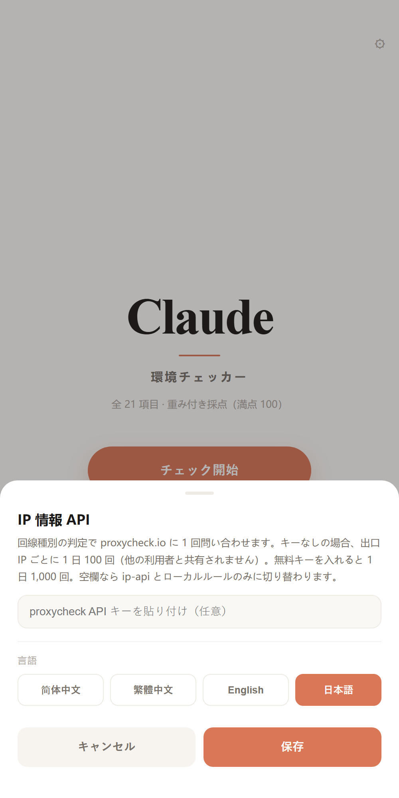

<div align="center">

# Claude 環境チェック

**プロキシを繋いでも、なぜ Claude は中国のユーザーと判定するのか？**

21 項目の端末シグナルを読み、重み付きで採点するネイティブ Android アプリ。プロキシはそのうちの 1 項目にすぎません。

[](LICENSE)
[](#インストール)
[](#インストール)
[](#プライバシー)

<p align="center">
  <a href="README.md"></a>
  <a href="README.zh-CN.md"></a>
  <a href="README.zh-TW.md"></a>
  <a href="README.ja.md"></a>
</p>

<div align="center">

</div>

</div>

---

## これは何か

スマホに入れる診断ツールです。端末がすでに発信している信号を読み取り、**この環境が普通の海外ユーザーに見えるか、それとも過去に印を付けられた特徴の集まりに見えるか**を教えます。

ブラウザ上のチェックと違い、これはネイティブの Android アプリです。ページからは決して取れない情報に触れられます。システムに入っているフォント、SIM の国、eSIM かどうか、複製アプリの有無、ROM が公式か、VPN が端末全体か。

結果は 100 点満点のスコアと一言の判定です。点数そのものより、**どの項目が足を引っ張っているか、なぜそうなるか、どう直すか**が重要です。

各項目の結果は「ラベル：値」の形で 1 行ずつ表示されます。値の色で正常・注意・異常を区別するため、デュアル SIM ならカード 1 が赤、カード 2 が緑になり、どちらに問題があるか一目で分かります。

読めなかったものは「合格」として扱いません。判別できない SIM や地域は「判定できません」と明示し、中間の点数にします。推測も、見逃しもしません。

<br>

<div align="center">
<table>
<tr>
<td></td><td></td><td></td>
</tr>
<tr>
<td align="center">ホーム</td><td align="center">項目ごとの検出</td><td align="center">スコアと判定</td>
</tr>
<tr>
<td></td><td></td><td></td>
</tr>
<tr>
<td align="center">明細</td><td align="center">項目の詳細</td><td align="center">設定</td>
</tr>
</table>
</div>

---

## 何を調べるか

21 項目。リスク判定における実際の重みで配点しています。**同じミスでも、項目によって代償はまったく違います。**

| 重み | 項目 | この重みの理由 |
|:---:|---|---|
| **20** | IP の所在地 | ポリシーに明記された絶対条件。即時否決 |
| **13** | IP 種別と健全度 | データセンターと家庭回線は扱いが別物。しかも「家庭回線」の多くは名前を変えたデータセンター |
| 7 | システムタイムゾーン | 物理的な居場所の最も直接的な傍証 |
| 6 | IPv6 リーク | トンネルを迂回する実際の出口 |
| 5 | WebRTC / タイムゾーンと IP / エミュレータ / 言語 / SIM | 単独では致命的でないが、重なると重い |
| 4 | ロケール / CJK フォント / 決済環境 | 中間層のシグナル |
| 3 | Root / メーカーフォント / 複製アプリ | 環境の信頼性 |
| 2 | 中国語の変種 / タイムゾーン偏移 | 細部の矛盾 |
| 1 | 端末モデル / ROM 状態 / プロキシ / 到達性 | 情報にはなるが、全体を沈めてはいけない |

判定ルール、隠れたヒューリスティクス、既知の誤判定は **[docs/DETECTION.md](docs/DETECTION.md)**（中国語）にまとめています。

### 5 つの即時否決

1 つでも該当すれば、点数に関係なく「使用しないでください」になります。

- システムタイムゾーンが中国本土のタイムゾーン
- 出口 IP が非対応地域
- IPv6 出口が IPv4 の地域と不一致
- WebRTC が別地域の公開アドレスを露出
- エミュレータまたはクラウド端末で実行

---

## 小さな例

同じ「減点」でも 20 倍の差があります。

```
端末モデルが中国版（Xiaomi など）  → 1 点減
IP が非対応地域                    → 20 点減、しかも即時否決
```

初期版は全項目 10 点でしたが、「端末が Xiaomi」と「中国本土にいる」が同じ減点になり、その点数に意味はありませんでした。

---

## インストール

**APK をインストール**

**[ClaudeDoctor.apk](https://github.com/know317028210-blip/claude-android-checker/releases/latest/download/ClaudeDoctor.apk)**（69 KB）を直接ダウンロードし、提供元不明アプリのインストールを許可してください。

バージョン履歴は [Releases](../../releases) にあります。

---

## 自分でビルド

Gradle は不要です。Android SDK（build-tools + platform 34）と JDK があれば足ります。

```bash
git clone https://github.com/<your-name>/claude-doctor.git
cd claude-doctor/android
bash build.sh
```

`aapt2 compile → link → javac → d8 → zipalign → apksigner` を順に実行し、69 KB の APK を作って接続中の端末にインストールします。

> 初回ビルドで `android/keystore.jks` が生成されます。署名鍵なので `.gitignore` で除外済みです。**コミットしないでください。**

---

## プライバシー

- 判定はすべて端末内で完結し、結果は外に出ません
- 外部に接続するのは IP 系の項目のみで、送るのは**出口 IP** だけです（照会に必須）
- 端末識別子、アカウント、位置情報、連絡先は送りません
- 解析もテレメトリもアカウントもありません

利用する外部 API と無料枠は [docs/DETECTION.md](docs/DETECTION.md) に記載しています。

---

## 位置づけ

これは**診断ツール**です。地域制限を回避する手段は提供せず、システム設定も変更しません。読んで、現状を伝えるだけです。

結果は参考情報であり、Anthropic 公式の判断ではありません。実際のリスク判定は動的で多次元です。

対応地域で普通の端末と家庭回線を使っていれば高得点になるはずです。低い場合は環境に矛盾があるので、ログイン前に片付ける価値があります。

---

## 自社運営リレー

**[Waterseller](https://waterseller.cc)** — 自社運営の Claude 中継サービス、品質保証
---

## コントリビュート

Issue と PR を歓迎します。特に歓迎するのは：

- **新しい項目** — ネイティブでしか取れないもの（センサー整合性、GPU モデル、DNS 出口）
- **誤検知の報告** — 実測値と根拠を添えてください。最も価値があります
- **翻訳** — 現在 zh-CN / zh-TW / en / ja
- **情報源** — キー不要で枠に余裕のある IP API

コード規約はありません。動いて意図が分かれば十分です。判定ロジックは `app/index.html` の `CHECKS` 配列にあり、追加はオブジェクトを 1 つ足すだけです。

---

## License

[MIT](LICENSE)

<div align="center">
<sub>ローカルで動き、何も送りません。終わったらタイムゾーンを直しましょう。</sub>
</div>
