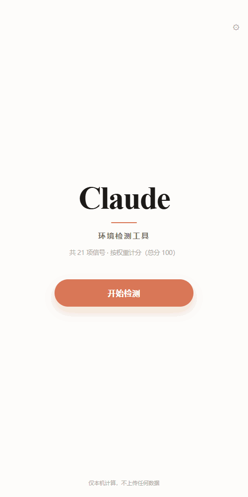
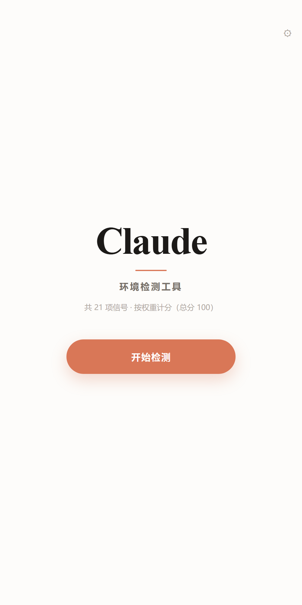
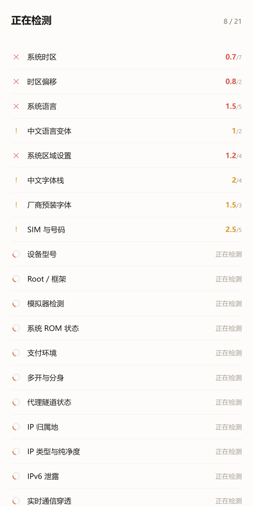
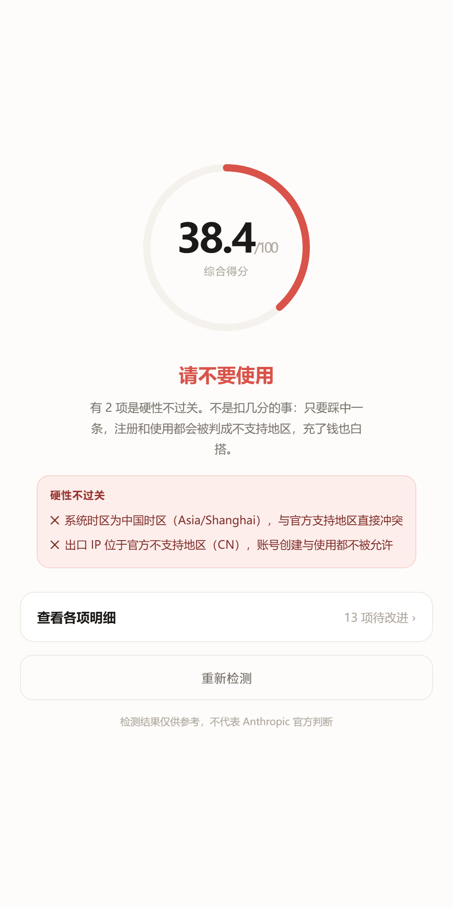
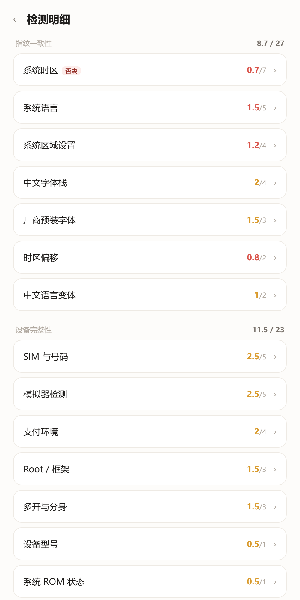
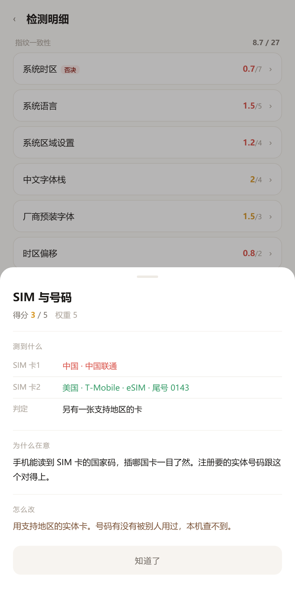
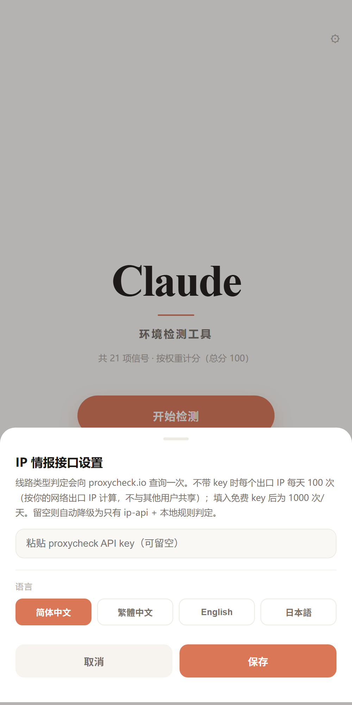

<div align="center">

# Claude 环境检测

**挂了代理，Claude 为什么还是把你当国内用户？**

一个原生安卓应用，读 21 项设备信号并按权重计分。代理只是其中一项。

[](LICENSE)
[](#安装)
[](#安装)
[](#隐私)

<p align="center">
  <a href="README.md"></a>
  <a href="README.zh-CN.md"></a>
  <a href="README.zh-TW.md"></a>
  <a href="README.ja.md"></a>
</p>

<div align="center">

</div>

</div>

---

## 这是什么

一个装在手机上的体检工具。它读一遍设备本身的信号，告诉你**这个环境更像一个普通海外用户，还是像一串被标记过的特征**。

和浏览器里跑的检测不同，这是个原生安卓应用。它能读到网页永远拿不到的东西：系统字体表里装了什么、SIM 卡归属哪个国家、是不是 eSIM、有没有开分身、系统是不是官方 ROM、VPN 是不是全局。

查完给一个 100 分的评分和一句结论。分数本身不重要，重要的是**哪一项在拖后腿、为什么、怎么改**。

每项结果按「标签：值」逐条列出，不是一段话丢给你。同一项里的不同取值，用颜色区分正常、注意、异常——比如双卡手机，卡 1 会被标红，卡 2 标绿，一眼看出是哪张卡的问题。

读不到的东西不会被当成通过。认不出的 SIM、解析不出的地区，会明确标成「无法判定」并给中间分，不猜、不放行。

<br>

<div align="center">
<table>
<tr>
<td></td><td></td><td></td>
</tr>
<tr>
<td align="center">首页</td><td align="center">逐项检测</td><td align="center">评分与结论</td>
</tr>
<tr>
<td></td><td></td><td></td>
</tr>
<tr>
<td align="center">各项明细</td><td align="center">单项详情</td><td align="center">设置</td>
</tr>
</table>
</div>

---

## 它查什么

21 项，按对风控的真实分量分配分数。**同样的错，在不同的项上代价完全不同**。

| 权重 | 检测项 | 为什么这个权重 |
|:---:|---|---|
| **20** | IP 归属地 | 官方政策写死的硬门槛，一票否决 |
| **13** | IP 类型与纯净度 | 机房与家宽待遇天差地别，且大量"家宽"是机房改名 |
| 7 | 系统时区 | 物理位置最直接的旁证 |
| 6 | IPv6 泄露 | 绕过隧道的真实出口 |
| 5 | 实时通信穿透 / 时区与 IP 一致性 / 模拟器 / 系统语言 / SIM 与号码 | 单项不致命，叠加起来很重 |
| 4 | 系统区域设置 / 中文字体栈 / 支付环境 | 画像的中层信号 |
| 3 | Root / 厂商字体 / 多开分身 | 环境可信度 |
| 2 | 中文语言变体 / 时区偏移 | 细节矛盾 |
| 1 | 设备型号 / ROM 状态 / 代理隧道 / 服务连通 | 有信息量，但不该拖垮总分 |

完整判定规则、隐藏规则和误判来源写在 **[docs/DETECTION.md](docs/DETECTION.md)**，包括每一项"什么算失败"。

### 五条一票否决

命中任何一条，结论直接是「请不要使用」，不看总分：

- 系统时区为中国大陆时区
- 出口 IP 位于官方不支持地区
- IPv6 出口与 IPv4 地区不一致
- 实时通信泄露了异地区公网地址
- 运行在模拟器或云手机

---

## 一个例子

同样是"扣分"，代价差 20 倍：

```
设备型号判错（国产机）      → 丢 1 分
IP 落在不支持地区           → 丢 20 分，且直接否决
```

这也是为什么每项不是平均 10 分。早期版本每项 10 分，结果"型号是小米"和"人在大陆"扣一样多的分，那个分数没有意义。

---

## 安装

**直接装 APK**

直接下载 **[ClaudeDoctor.apk](https://github.com/know317028210-blip/claude-android-checker/releases/latest/download/ClaudeDoctor.apk)**（69 KB），允许安装未知来源即可。

也可以到 [Releases](../../releases) 查看版本历史。

---

## 自己编译

不需要 Gradle，只要 Android SDK（build-tools + platform 34）和 JDK。

```bash
git clone https://github.com/<your-name>/claude-doctor.git
cd claude-doctor/android
bash build.sh
```

脚本会依次跑 `aapt2 compile → link → javac → d8 → zipalign → apksigner`，产出 69 KB 的 APK 并自动装到已连接的设备。

> 首次构建会在 `android/` 下生成 `keystore.jks`。这个文件是签名私钥，已在 `.gitignore` 里排除，**不要提交**。

---

## 隐私

- 所有判定在本机完成，结果不离开设备
- 只有 IP 类检测会向情报接口发送你的**出口 IP**，这是查询本身的必要条件
- 不发送设备标识、账号、位置、通讯录或任何其他数据
- 没有统计、没有埋点、没有账号体系

用到的外部接口和免费额度写在 [docs/DETECTION.md](docs/DETECTION.md#六外部接口与配额)。

---

## 说明

这是一个**诊断工具**，不提供任何绕过地区限制的手段，也不修改任何系统设置——它只读取，然后告诉你现状。

结果仅供参考，不代表 Anthropic 官方判断。实际风控是动态的、多维的，本工具给出的是基于公开政策与社区观察的风险画像。

如果你在支持地区、用正常设备和家宽，本该拿高分；如果分数很低，说明环境确实存在可识别的矛盾，值得先处理再登录。

---

## 赞助

**[Waterseller](https://waterseller.cc)** · 自营 Claude 中转站

<sub>商业推广，与本工具无隶属关系。</sub>


---

## 参与

欢迎提 Issue 和 PR。特别欢迎这几类：

- **新的检测项**：尤其是只有原生环境能做到的（传感器一致性、GPU 型号、DNS 出口）
- **误判反馈**：附上你的实测值和判断依据，这类反馈最有价值
- **翻译**：目前有简中、繁中、英、日，其他语言欢迎补
- **情报源**：找到不需要 key、额度友好的 IP 情报接口

代码风格没什么讲究，能跑、能说明白就行。检测逻辑集中在 `app/index.html` 的 `CHECKS` 数组里，加一项就是加一个对象。

---

## License

[MIT](LICENSE)

<div align="center">
<sub>本地跑，不上传。查完记得改时区。</sub>
</div>
