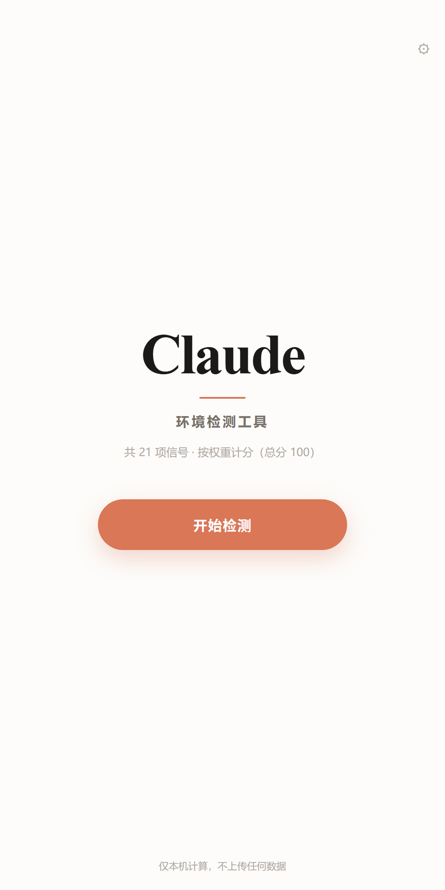
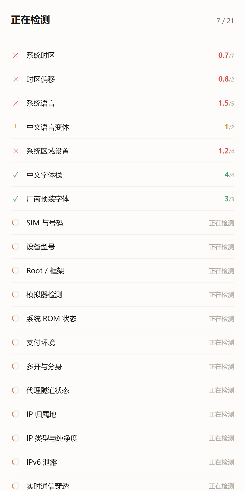
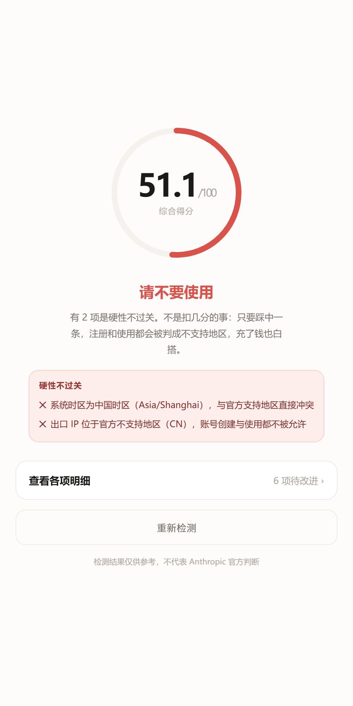
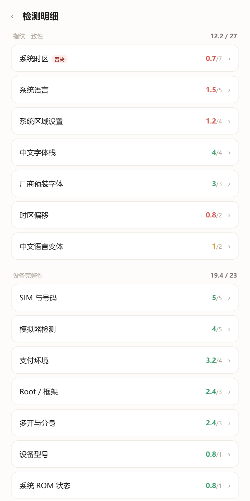
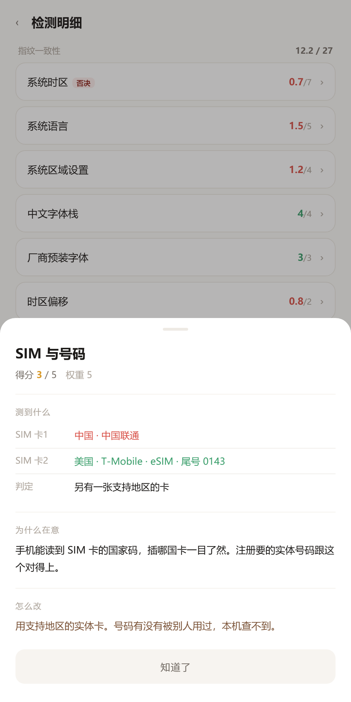
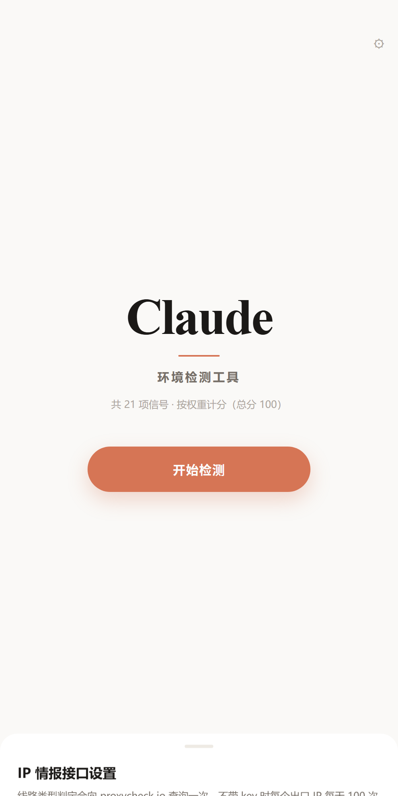
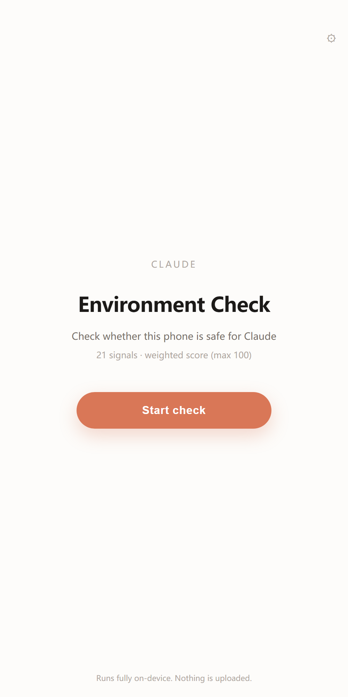
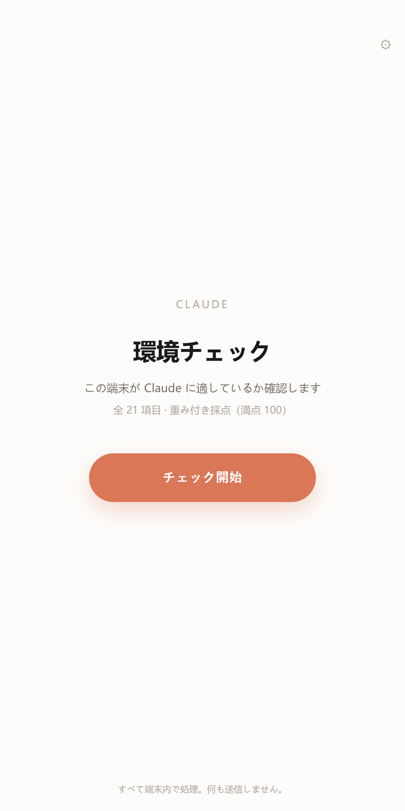

<div align="center">

# Claude 環境檢測

**在打開 Claude 之前，先看一眼這台裝置乾不乾淨。**

21 項訊號 · 依權重計分 · 全程本機 · 開源

[](LICENSE)
[](#安裝)
[](#安裝)
[](#隱私)

[简体中文](README.md) · **繁體中文** · [English](README.en.md) · [日本語](README.ja.md)

</div>

---

## 這是什麼

一個裝在手機上的體檢工具。它讀一遍裝置本身的訊號，告訴你**這個環境更像一個普通的海外使用者，還是像一串被標記過的特徵**。

和網頁版檢測不同，這是原生 Android 應用。它能讀到網頁永遠拿不到的東西：系統字型表裡裝了什麼、SIM 卡歸屬哪個國家、是不是 eSIM、有沒有開分身、系統是不是官方 ROM、VPN 是不是全域。

查完給一個 100 分的評分和一句結論。分數本身不重要，重要的是**哪一項在拖後腿、為什麼、怎麼改**。

<br>

<div align="center">
<table>
<tr>
<td></td>
<td></td>
<td></td>
<td></td>
</tr>
<tr>
<td align="center">首頁</td>
<td align="center">逐項檢測</td>
<td align="center">評分與結論</td>
<td align="center">各項明細</td>
</tr>
<tr>
<td></td>
<td></td>
<td></td>
<td></td>
</tr>
<tr>
<td align="center">單項詳情</td>
<td align="center">介面與語言設定</td>
<td align="center">English</td>
<td align="center">日本語</td>
</tr>
</table>
</div>

---

## 它查什麼

21 項，依對風控的真實分量分配分數。**同樣的錯，在不同的項上代價完全不同**。

| 權重 | 檢測項 | 為什麼是這個權重 |
|:---:|---|---|
| **20** | IP 歸屬地 | 官方政策寫死的硬門檻，一票否決 |
| **13** | IP 類型與純淨度 | 機房與家用寬頻待遇天差地別，且大量「家用寬頻」是機房改名 |
| 7 | 系統時區 | 物理位置最直接的旁證 |
| 6 | IPv6 洩漏 | 繞過隧道的真實出口 |
| 5 | 即時通訊穿透 / 時區與 IP 一致性 / 模擬器 / 系統語言 / SIM 與號碼 | 單項不致命，疊加起來很重 |
| 4 | 系統區域設定 / 中文字型堆疊 / 支付環境 | 画像的中層訊號 |
| 3 | Root / 廠商字型 / 多開分身 | 環境可信度 |
| 2 | 中文語言變體 / 時區偏移 | 細節矛盾 |
| 1 | 裝置型號 / ROM 狀態 / 代理隧道 / 服務連通 | 有資訊量，但不該拖垮總分 |

完整判定規則、隱藏規則與誤判來源寫在 **[docs/DETECTION.md](docs/DETECTION.md)**，包含每一項「什麼算失敗」。

### 五條一票否決

命中任何一條，結論直接是「請不要使用」，不看總分：

- 系統時區為中國大陸時區
- 出口 IP 位於官方不支援地區
- IPv6 出口與 IPv4 地區不一致
- 即時通訊洩露了異地區公網位址
- 執行於模擬器或雲手機

---

## 一個例子

同樣是「扣分」，代價差 20 倍：

```
裝置型號判錯（中國版機型）    → 丟 1 分
IP 落在不支援地區             → 丟 20 分，且直接否決
```

這也是為什麼每項不是平均 10 分。早期版本每項 10 分，結果「型號是小米」和「人在大陸」扣一樣多的分，那個分數沒有意義。

---

## 安裝

**方式一：直接裝 APK**

到 [Releases](../../releases) 下載 `ClaudeDoctor.apk`，允許安裝未知來源即可。

**方式二：網頁版（功能相同，少了原生那幾項）**

瀏覽器打開 `app/index.html`。網頁版讀不到字型表、SIM 歸屬、Root、分身，這幾項會標註為「網頁環境無法讀取」，而不是假裝通過。

**方式三：電腦端**

```bash
# Windows
desktop/doctor-lite/ClaudeDoctorLite.exe

# macOS / Linux
bash desktop/claude-env-check.sh
```

---

## 自己編譯

不需要 Gradle，只要 Android SDK（build-tools + platform 34）和 JDK。

```bash
git clone https://github.com/<your-name>/claude-doctor.git
cd claude-doctor/android
bash build.sh
```

腳本會依序執行 `aapt2 compile → link → javac → d8 → zipalign → apksigner`，產出 61 KB 的 APK 並自動裝到已連接的裝置。

> 首次建置會在 `android/` 下產生 `keystore.jks`。這個檔案是簽章私鑰，已在 `.gitignore` 排除，**不要提交**。

---

## 隱私

- 所有判定在本機完成，結果不離開裝置
- 只有 IP 類檢測會向情報介面發送你的**出口 IP**，這是查詢本身的必要條件
- 不發送裝置識別碼、帳號、位置、通訊錄或任何其他資料
- 沒有統計、沒有埋點、沒有帳號體系

使用到的外部介面與免費額度寫在 [docs/DETECTION.md](docs/DETECTION.md#六外部接口与配额)。

---

## 說明

這是一個**診斷工具**，不提供任何繞過地區限制的手段，也不修改任何系統設定——它只讀取，然後告訴你現況。

結果僅供參考，不代表 Anthropic 官方判斷。實際風控是動態的、多維的，本工具給出的是基於公開政策與社群觀察的風險画像。

如果你在支援地區、用正常裝置和家用寬頻，本該拿高分；如果分數很低，說明環境確實存在可識別的矛盾，值得先處理再登入。

---

## 參與

歡迎提 Issue 和 PR。特別歡迎這幾類：

- **新的檢測項**：尤其是只有原生環境能做到的（感測器一致性、GPU 型號、DNS 出口）
- **誤判回饋**：附上你的實測值和判斷依據，這類回饋最有價值
- **翻譯**：目前有簡中、繁中、英、日，其他語言歡迎補
- **情報源**：找到不需要 key、額度友善的 IP 情報介面

程式風格沒什麼講究，能跑、能說明白就行。檢測邏輯集中在 `app/index.html` 的 `CHECKS` 陣列裡，加一項就是加一個物件。

---

## License

[MIT](LICENSE)

<div align="center">
<sub>本機執行，不上傳。查完記得改時區。</sub>
</div>
